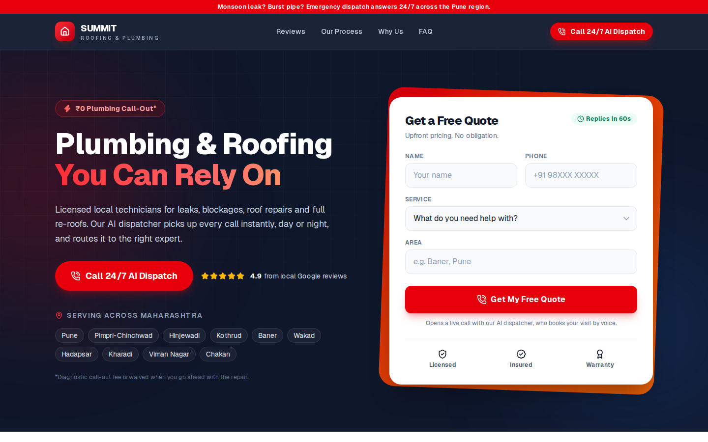
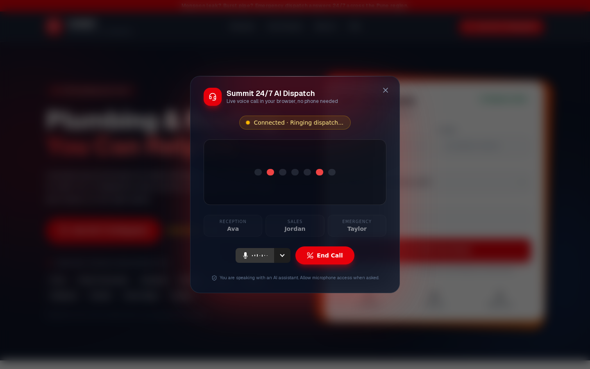

# Summit Roofing & Plumbing: website with a live AI voice dispatcher

A Next.js landing page for a local trades business in the Pune region. Every "Call" button opens a
glassmorphic modal that connects the visitor to the LiveKit voice agents (Ava, Jordan, Taylor) in
`summit-voice-agents/`, instead of opening a phone dialer.

Built for the VIT Bhopal project exhibition.




## Run it

```bash
npm install
cp .env.example .env.local   # fill in your LiveKit Cloud project
npm run dev                  # http://localhost:3000
```

Start the Python workers (`agent.py`, `sales_agent.py`, `support_agent.py`) against the **same**
LiveKit project, then click any red Call button.

## Environment variables (local `.env.local` and Vercel)

| Name | Example | Notes |
| --- | --- | --- |
| `LIVEKIT_URL` | `wss://your-project.livekit.cloud` | Same project as the workers |
| `LIVEKIT_API_KEY` | `APIxxxx` | Server-only |
| `LIVEKIT_API_SECRET` | `...` | Server-only |

None of them needs a `NEXT_PUBLIC_` prefix. The token route returns the server URL alongside the
token, so the browser gets it from there and the URL lives in one place. If you already set
`NEXT_PUBLIC_LIVEKIT_URL`, the route accepts it as a fallback for `LIVEKIT_URL`.

On Vercel: Project → Settings → Environment Variables, add the three, then redeploy.

## Stack

Next.js 16 (App Router), React 19, TypeScript, Tailwind CSS v4, `lucide-react`,
`livekit-client`, `@livekit/components-react`, `@livekit/components-styles`, `livekit-server-sdk`.

## Files

### `app/api/token/route.ts`

`GET /api/token` signs a LiveKit `AccessToken` and returns `{ token, serverUrl, roomName, identity }`.

- Identity: `exhibition_guest_<6 digits>`.
- Grants: `roomJoin`, `canPublish`, `canSubscribe` (plus `canPublishData`), valid 15 minutes.
- Marked `force-dynamic` and `Cache-Control: no-store`, so every click gets a fresh token.
- Returns a readable 500 naming any missing env var.

**Room name.** Each call joins its own room, `support_triage_room_<random>`. The prefix is the
`ROOM_PREFIX` constant at the top of the file. This is deliberate, not a fixed
`support_triage_room`:

1. Ava's worker has no `agent_name`, so LiveKit auto-dispatches her into every new room. The Python
   workers never look at the room name, so the suffix changes nothing on the backend.
2. Ava's assistant listens only to the first guest in a room. In one shared room, a second visitor,
   or the same visitor redialling quickly, would join a room where nobody is listening.
3. When a booking or ticket finishes, the backend deletes the room, so the next caller gets a fresh
   room anyway.

### `components/AICallModal.tsx`

Props: `isOpen`, `onClose`.

- Renders nothing while closed. The token is fetched and `<LiveKitRoom>` is mounted only after a
  click opens it, which keeps the browser's autoplay and microphone rules happy.
- Overlay: `fixed inset-0 z-50 bg-black/60 backdrop-blur-md`; dark translucent glass card with a red
  glow. Esc, the X, or a click outside closes it; page scroll is locked while open.
- Inside `<LiveKitRoom audio video={false}>`:
  - `<RoomAudioRenderer />` plays the agents' voices.
  - `<BarVisualizer />` fed by `useVoiceAssistant()` is the centrepiece and reacts when the AI speaks.
  - A status pill driven by `useConnectionState()` and the agent state: Connecting, Ringing dispatch,
    Ava is speaking, Listening to you, Transferring your call, Reconnecting.
  - Ava / Jordan / Taylor cards light up for whoever is on the line (the backend sets each agent's
    participant name).
  - `<VoiceAssistantControlBar />` for mic mute and device choice.
  - A red **End Call** button that calls `room.disconnect()` and closes the modal.
  - `<StartAudio />` appears only if Safari-style autoplay rules still block audio.
- **When the agent hangs up** (the backend deletes the room), the modal shows "Call ended" for about
  two seconds, then closes itself. Every opening remounts the call with a new key, so a redial starts
  clean.
- Errors (mic blocked, no mic, server unreachable, missing env vars) show a clear message with a
  Close button.

### `app/page.tsx`

Client component holding `isModalOpen`. Sections:

1. **Navbar & Hero**: navy sticky header with an emergency strip and a red "Call 24/7 AI Dispatch"
   button; split hero with the "₹0 Plumbing Call-Out*" badge, the headline, Maharashtra service areas,
   and a "Get a Free Quote" card. The quote form's submit opens the AI call (the dispatcher takes the
   details by voice; the form itself sends nothing).
2. **Trust bar** and **Genuine Local Service**: two 5-star Google-style review cards.
3. **Our 6-Step Process**: vertical timeline, one Lucide icon per step; step 2 "AI Dispatch &
   Routing" is highlighted with a "Live AI" tag.
4. **Why Choose Us (FAQ)**: the four-point checklist (Upfront pricing, No hidden costs, Fully
   licensed, Clean and respectful) and an FAQ accordion whose answers match what Ava says on the call.
5. Emergency call-to-action band and footer.

Every section has a red Call button, and phones get a sticky Call bar at the bottom.

## Content notes

- The asterisk on "₹0 Plumbing Call-Out*" is explained under the hero: the diagnostic fee is waived
  when the customer goes ahead, which is exactly what Ava tells callers.
- Reviews, the 4.9 rating and the service areas are illustrative; the footer says so.

## Tested

`npm run lint` and `npm run build` pass. Against a local `livekit-server --dev` with a fake
microphone in Chromium: the modal connects to a `support_triage_room_<random>` room, a server-side
room delete (what the backend does on hangup) shows "Call ended" and closes the modal, a redial gets a
new room, and End Call leaves the room empty. The real Python agents were not part of that test.
